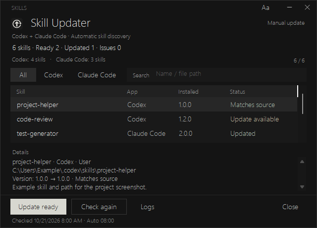

# Skill Updater for Codex and Claude Code

A compact Windows app to discover installed Codex and Claude Code skills, check supported update sources, and update eligible skills from one place. Use it on demand, or enable an 08:00 daily update with a manual check window at Windows sign-in.

[Download the latest release](https://github.com/sixmillorcore-star/skill-updater/releases/latest) · [คู่มือภาษาไทย](docs/README.th.md) · [Validation](docs/VALIDATION.md)



The screenshot uses demonstration data and example paths.

## What it does

- Finds skills in user folders, known projects, system locations, and installed plugins for both Codex and Claude Code.
- Filters by app and searches skill names, sources, statuses, and file paths.
- Checks available versions and updates only entries with a supported, verifiable source.
- Keeps local backups before supported updates and records results in the `data` folder.
- Checks GitHub for new versions of Skill Updater and lets you download, verify, and install them inside the app.
- Offers a dark interface, a minimum window size of 640 × 460, selectable fonts, and four complete detail lines with scrolling for longer text.
- Includes 20 interface languages. The default follows Windows; other selectable languages use an explicit English fallback when no translation is available.

## Get started

Requires Windows, .NET Framework, and Windows PowerShell 5.1. Plugin updates also require the relevant Codex or Claude Code CLI. Either app can be used independently; both do not have to be installed.

1. Download the application ZIP from [Releases](https://github.com/sixmillorcore-star/skill-updater/releases/latest) and extract the entire folder.
2. Open `SkillUpdater.exe`. Keep its PowerShell scripts, `languages` folder, icon, and `settings.json` beside it.
3. Review the detected skills. Select **Check again** to refresh versions, or **Update ready** when supported updates are available.
4. Use **Aa** to choose the interface language, font, and text size.
5. Select the version button in the top bar to open **App update**.

The update action applies to all eligible entries, including entries hidden by a filter. Checking versions does not install updates.

### Update Skill Updater itself

From version 1.1.0, the app checks the latest stable [GitHub Release](https://github.com/sixmillorcore-star/skill-updater/releases/latest) when it opens and about every six hours while open. A new version adds a mark to the version button and displays a notification. Open **App update**, then select **Update and restart**. You can also check manually there. App updates always require a click, including when the morning skill update runs automatically.

The app downloads the matching Windows ZIP, verifies GitHub's SHA-256 asset digest and the package's file manifest, then installs after the current window closes. Your `settings.json`, `data` folder, skills, scheduled tasks, and shortcuts are preserved. The previous program files are backed up under `data/app-updates`; a failed file replacement attempts to restore them. Finish any skill operation and close other instances from the same folder before updating. The installation folder must be writable.

Version 1.0.0 needs a one-time manual upgrade to enable this feature: close the app, extract the latest ZIP, and copy its program files into the existing folder **without replacing `settings.json` or deleting `data`**. Checksums verify downloaded content; the Windows binary is not code-signed.

### Optional startup and morning updates

Run `Install.cmd` from the extracted application folder to create per-user shortcuts and scheduled tasks with limited privileges:

| Trigger | Behavior |
| --- | --- |
| Daily at 08:00, local time | Updates eligible skills and shows the result when the computer was on before 08:00 and the user is signed in. |
| Windows sign-in, after about 20 seconds | Opens the manual check window. You choose whether to update. |

A missed morning run is not caught up automatically, and the app does not wake the computer. While the window is open, it checks for newly installed skills approximately every five minutes.

Keep the installed folder in place. To move it, run `Uninstall.cmd` in the old folder before running `Install.cmd` in the new location. Uninstalling removes this installation's tasks and shortcuts; it does not delete skills or plugins.

## Which skills can be updated?

Discovery and update support are separate. A skill can appear in the list even when its update must be handled elsewhere.

| Source | Update behavior |
| --- | --- |
| Installed Codex plugins | Uses available provider version information and the Codex CLI for supported updates. Catalog data can be cached. |
| Installed Claude Code plugins | Uses verifiable local marketplace information and the Claude Code CLI, retaining the original scope. |
| System, runtime, app-managed, or synced skills | Reports their status; the owning app or source controls their version. |
| Local skills | Updates only when an explicit supported local source is configured. Skills without a known source remain manual. |

Locally edited files that differ from their baseline are skipped. Disabled entries are shown but not updated. The app does not install every newly published skill or reinstall removed plugins.

## Configuration and local data

Automatic discovery uses the usual Codex and Claude Code locations, including `CODEX_HOME` and `CLAUDE_CONFIG_DIR` when set. It scans known projects rather than searching an entire drive.

Use `settings.json` to add `skillRoots`, `claudeSkillRoots`, `sharedSkillRoots`, or `projectRoots`, and to configure supported `localSources`. The distributed configuration contains no personal machine paths.

Interface preferences are stored separately in `data/ui-preferences.json`. Reports, update history, and backups also stay under `data`. These files can contain local paths and should remain private.

The updater does not require an AI API key. Version checks and supported updates use the installed provider tools and their configured sources.

## Build from source

The build uses the .NET Framework C# compiler available on Windows; no separate web runtime or Node.js package installation is needed.

```powershell
git clone https://github.com/sixmillorcore-star/skill-updater SkillUpdater
cd SkillUpdater
powershell.exe -NoProfile -ExecutionPolicy Bypass -File .\Build.ps1
.\SkillUpdater.exe
```

Build before running `Install.cmd`. You can run the executable directly without installing scheduled tasks.

`Package.ps1` builds the Windows release ZIP, its file manifest, and `SHA256SUMS.txt`. It uses `CurrentVersion` in `AppUpdate.cs`, which also supplies the executable's assembly and file versions through `AppVersion.cs`. An explicit `-Version` must match. Future releases must retain the asset name `SkillUpdater-vX.Y.Z-windows.zip`, the top-level `SkillUpdater` folder, and `app-update-manifest.json` for in-app updates to work.

## Validation

The compact layout was checked across 20 languages and five text sizes. Detail rendering was tested at fractional control heights and while scrolling to the end of long text. See [validation and test limits](docs/VALIDATION.md) for the recorded scope and reproduction instructions.

Claude Code discovery and update behavior were tested with isolated file, registry, and CLI fixtures. A real Claude Code plugin update was not exercised in the original development environment.
